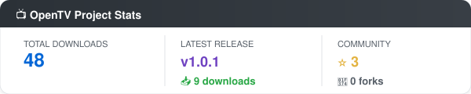
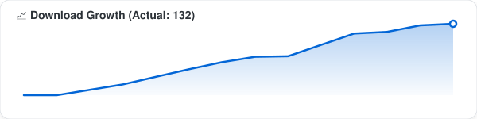

# OpenTV

**La TV libera su ogni schermo.**

Player IPTV nativo e multipiattaforma per i canali free-to-air — Android, Android TV, Windows e Linux.

 

[English](README.md) · **Italiano**

---

## Che cos'è OpenTV?

OpenTV è un'applicazione multipiattaforma nativa per guardare i canali TV liberi via IPTV, con un
focus sui **canali italiani**. All'avvio recupera la playlist pubblica in base al paese dell'utente
dal progetto [iptv-org](https://iptv-org.github.io/), la mostra in un'interfaccia in stile
"Dark TV" e riproduce gli stream disponibili.

Un'unica app per ogni dispositivo: **telefono/tablet**, **Android TV / TV box**, Windows e Linux.
La stessa UI adatta focus, dimensioni e controlli al dispositivo rilevato (D-pad vs touch).

> ⚠️ **Nota legale**: OpenTV è un *riproduttore* generico. Non fornisce,
> ospita né seleziona alcun contenuto: gli stream provengono da playlist
> pubbliche di terze parti. Utilizzala solo con canali la cui fruizione è
> legale nel tuo paese (es. canali free-to-air).

## In evidenza

- **Pronta all'uso** — i canali del tuo paese sono disponibili al primo avvio, senza configurazione.
- **Guida TV inclusa** — in onda/a seguire, programmazione completa e guida a griglia, tutto in automatico.
- **Pensata per il salotto** — navigazione D-pad, banner TV, player che parla col telecomando.
- **Non perderti nulla** — promemoria programmi, preferiti e cronologia per ogni sorgente.
- **Non si ferma mai** — fallback offline, riconnessione automatica, cache delle playlist di 6 ore.

**Indice**

- [Che cos'è OpenTV?](#che-cosè-opentv)
- [In evidenza](#in-evidenza)
- [Funzionalità](#funzionalità)
  - [Canali e sorgenti](#canali-e-sorgenti)
  - [Riproduzione](#riproduzione)
  - [Guida TV (EPG)](#guida-tv-epg)
  - [Trova i canali in un attimo](#trova-i-canali-in-un-attimo)
- [Android TV e telefono](#android-tv-e-telefono)
- [Extra desktop](#extra-desktop)
- [Screenshot](#screenshot)
- [Configurazione](#configurazione)
  - [Playlist canali](#playlist-canali)
  - [Guida TV (XMLTV)](#guida-tv-xmltv)
- [Risoluzione problemi](#risoluzione-problemi)
- [Licenza](#licenza)

## Funzionalità

### Canali e sorgenti

- **Canali per paese (sorgente automatica)** — all'avvio l'app rileva la
  nazione del dispositivo (rete mobile, poi SIM, poi impostazioni locali di
  sistema) e carica la playlist iptv-org curata di quel paese, con la guida
  TV dello stesso paese derivata in automatico e mirror grezzo come riserva.
  Ideale per usi internazionali: ogni installazione vede i canali locali.
  Dalla Home un **chip con bandierina** permette di cambiare nazione al
  volo (la scelta si applica subito ed è persistita: resta anche dopo il
  riavvio, mentre il default "Automatica" segue il paese del dispositivo);
  nelle impostazioni c'è il selettore completo (paesi con catalogo
  iptv-org, ordinati per nome nella lingua di sistema) oppure è possibile
  disattivare la sorgente automatica per usare un
  **URL personalizzato** (o importare una lista da file, che mantiene la
  priorità). Su desktop il paese segue il locale del sistema.
  Le bandierine sono emoji su Android e **PNG incorporate** su desktop
  (fonte flagcdn.com): Windows non dispone dei glifi emoji per le
  bandiere nel font di sistema e mostrerebbe la sigla al loro posto.

- **Recupero playlist IPTV** — download M3U/M3U8 con parser dedicato
  (`tvg-id`, `tvg-logo`, `group-title`), cache locale con TTL di 6 ore e
  **fallback offline** sull'ultima cache valida.

- **Esporta/Importa lista** — backup della lista canali su file M3U e
  importazione da file locale tramite il selettore di sistema (SAF); la
  lista importata resta la sorgente attiva (con fallback offline) finché
  non si torna a un URL remoto.

- **Esporta/Importa profilo** — ogni profilo di sorgente si esporta in un
  unico pacchetto `.opentv` che contiene il profilo (nome, URL playlist,
  URL guida) e i canali della sua playlist, guida incorporata compresa;
  l'importazione è generica e riconosce il pacchetto dal contenuto: il
  profilo viene creato (o, con un dialog di conferma, sovrascritto se
  esiste già con lo stesso nome), attivato, e i suoi canali diventano la
  lista caricata. Le playlist importate controllano identificatori e URL
  duplicati dei canali: la lista canali non va più in crash per chiavi doppie.

### Riproduzione

- **Motore Media3/ExoPlayer** — supporto HLS/DASH/MPEG-TS,
  redirect cross-protocol, riprove progressivo per i flussi ambigui,
  audio focus e gestione "becoming noisy" (pause automatiche quando si
  staccano le cuffie).

- **Riconnessione automatica dello stream** — se un flusso cade (hiccup CDN,
  timeout di rete) il player riprova da solo con backoff crescente (1.5s,
  4s, 8s — fino a 3 tentativi) mostrando "Riconnessione… (tentativo N di 3)"
  invece di lasciare la schermata d'errore; l'immagine resta a schermo e il
  ritorno del segnale è immediato. Su Android la diagnosi del sorgente
  (geo-blocco, link morto, segnaposto…) compare solo dopo l'ultimo tentativo.

- **Precedente/Successivo** — cambio canale direttamente dal player, come sul
  telecomando.

- **Sottotitoli** — menu di selezione tracce sottotitoli gemello del menu
  tracce audio, su Android (bottom sheet, tracce di testo ExoPlayer) e
  desktop (menu a tendina, tracce SPU di libVLC): voce "Disattivati"
  sempre disponibile, traccia attiva evidenziata, icona CC nella barra che
  si accende quando i sottotitoli sono attivi. I flussi senza tracce di
  testo non mostrano il pulsante; al cambio canale la scelta torna automatica.

### Guida TV (EPG)

- **EPG automatica (XMLTV)** — con playlist iptv-org carica da sola la guida
  per paese di iptv-epg.org (oppure URL manuale, anche `.gz`); le playlist
  che dichiarano la **propria guida nell'header** (`x-tvg-url`, anche come
  lista di URL) la ottengono senza configurare nulla — mostra
  *in onda adesso* e *a seguire* sulle card e nel player, più la
  **programmazione completa** del canale (finestra -1h → +24h, raggruppata
  per giorno) nel player Android (bottom sheet) e desktop (pannello laterale).

- **Guida TV a griglia** — schermata dedicata (icona TV in Home): canali sulle
  righe e programmi sulla linea del tempo orizzontale, finestra di 4 ore che
  parte dall'ora piena corrente, il programma **in onda** è evidenziato col
  bordo primario e una barra di avanzamento viva; un tap su qualunque
  programma (o canale) apre direttamente il player. Lo scroll orizzontale è
  condiviso e allineato fra tutte le righe e il righello orario, con il
  marker "adesso".

- **Promemoria programmi ("avvisami quando inizia")** — campanello su ogni
  programma futuro nella programmazione del canale (player Android e
  desktop): il promemoria resta salvato sul dispositivo e, all'inizio del
  programma, arriva una notifica di sistema (canale dedicato su Android,
  fumetto della tray su desktop). Le voci dei programmi finiti da più di due
  ore (es. dispositivo spento) vengono pulite in silenzio; funziona anche
  con l'app in background (Android) o in Home/guida (desktop).

### Trova i canali in un attimo

- **Preferiti per sorgente** — tap prolungato su una card (o stella nel
  player) e sezione dedicata. **Ogni lista ha i suoi preferiti**: quelli della
  sorgente automatica (iptv-org) e quelli di ciascun profilo di sorgente sono
  elenchi indipendenti — passando da un profilo all'altro la riga Preferiti
  (col nome della lista attiva nel titolo) mostra solo i canali marcati su
  quella sorgente, senza mai mescolare o perdere gli altri.

- **Ultimi visti** — cronologia automatica dei canali guardati, in cima alla Home.

- **Ricerca live** — filtro per nome insensibile a maiuscole/accenti.

- **Filtro per gruppo (genere)** — riga di chip sotto la barra superiore con
  i `group-title` della playlist (es. News, Movies, Sports, Music): un tap
  mostra solo i canali del genere scelto, con il numero di canali per gruppo.
  Le categorie multiple ("Movies;Series") contano il canale in ogni genere;
  i canali senza gruppo finiscono in "Senza categoria". Combinabile con la
  ricerca; "Tutti" rimuove il filtro. **La scelta persiste** tra le sessioni
  e sulla card di ogni canale compare un badge col suo genere:
  su telefono e desktop il badge è **cliccabile** (un tap filtra quel genere
  e la riga di chip si allinea da sola al gruppo scelto), su Android TV resta
  decorativo per non aggiungere target di focus alla navigazione D-pad.

## Android TV e telefono

- **Android TV** — launcher Leanback, banner TV, navigazione **D-pad**
  completa (frecce per muoversi tra card e righe, tasto centrale per
  aprire/interagire, `back` per uscire) con scala + glow sul focus, schermo
  sempre attivo in riproduzione. Banner (`tv_banner`) e icone adattive
  incluse; icone PNG legacy per Android 7.0–7.1.

- **Player TV** — **qualunque tasto del telecomando** (OK, frecce D-pad,
  tasti media) fa comparire i controlli, compreso il pulsante **preferito**;
  il focus parte da play/pausa e ogni pressione rinvia di 4 secondi
  l'auto-nascondimento. CH+/CH− (o PageUp/PageDown) passano direttamente al
  canale successivo/precedente, i tasti play/pausa del telecomando funzionano
  sempre, e `back` prima nasconde i controlli poi esce dal player.

- **Telefono** — landscape forzato + modalità immersiva a schermo intero.

- **Comandi di sistema (Android)** — media session sul player: play/pausa
  dal lockscreen e dai tasti degli auricolari Bluetooth, "traccia
  successiva/precedente" = canale successivo/precedente, notifica persistente
  con canale e programma in onda e pulsanti (precedente, play/pausa,
  successivo). Richiede il permesso notifiche su Android 13+ (richiesto
  all'apertura del player): negandolo sparisce solo la notifica, i comandi
  restano.

## Extra desktop

**Scorciatoie da tastiera e mouse nel player desktop**:

| Tasto | Azione |
|-------|--------|
| `Spazio` | play / pausa |
| `←` / `→` | canale precedente / successivo |
| `↑` / `↓` | volume (indicatore temporaneo nella barra inferiore) |
| Rotella del mouse sul video | volume (un cric = ±10, indicatore temporaneo nella barra inferiore; con il puntatore fuori dal video la rotella continua a scorrere i contenuti) |
| `F` | schermo intero / ripristina finestra |
| `Esc` | esce dallo schermo intero (se attivo), altrimenti torna alla lista dei canali |

**Schermo intero vero** — si attiva anche dal **pulsante in barra** del
player (icona che alterna entra/esci in base allo stato della finestra);
uscendo dal canale la finestra torna automaticamente in modalità normale.

Lo schermo intero è **davvero a bordo a bordo**: la finestra desktop è
senza decorazioni di sistema e la barra del titolo (riduci/ingrandisci/
chiudi, trascinabile, doppio click = ingrandisci) è disegnata dall'app
nello stesso stile scuro della UI, implementata in modalità **borderless**
per una resa identica e una transizione senza sfarfallii né sfondi bianchi.

Le barre del player **spariscono dopo 4 secondi di inattività in ogni
modalità** (finestra e schermo intero); a schermo intero viene nascosto
anche il cursore; il primo movimento del mouse o un tasto qualsiasi le rende
di nuovo visibili. Le barre vivono in **slot a dimensione fissa** fuori
dall'area video: nasconderle è un effetto puramente grafico (dissolvenza) e
la superficie video **non viene mai ridimensionata né coperta** — le zone
lasciate libere restano nere, coerenti col tema. In modalità finestra la
barra del titolo resta sempre disponibile per trascinare e chiudere la finestra.

**Zapping numerico (desktop)** — nel player digiti le cifre del canale
("103") e al volo si apre il canale 103 della playlist: le cifre
compaiono in un chip nella barra, il canale parte alla scadenza del
buffer (1,2s) o premendo Invio, il backspace corregge.

**Statistiche stream (desktop)** — pannello stile VLC nel player (tasto I
o pulsante ⓘ): codec e risoluzione video, fps, codec e bitrate audio,
bitrate di demux e perdite segnalate da libVLC (fotogrammi, buffer
audio, discontinuità, pacchetti corrotti): utile per capire perché un
canale va a scatti. I dati vivono nella barra, mai sopra il video.

**Mini-player (desktop)** — il pulsante PiP del player sposta la visione
in una finestretta sempre in primo piano nell'angolo in basso a destra:
si guarda la partita mentre si sfoglia la guida o la Home. Striscia
trascinabile con titolo, pulsante espandi (riapre il player pieno) e
chiusura; aprendo un canale la finestretta si chiude da sola (una sola
riproduzione attiva).

## Screenshot

| Home (telefono) | Home (Android TV / Desktop) | Player |
|---|-----------------------------|---|
|  |  |  |

## Configurazione

### Playlist canali

- **Predefinita**: `https://iptv-org.github.io/iptv/countries/it.m3u` (canali
  disponibili nel proprio paese elencati dalla community iptv-org, aggiornata quotidianamente).
- **Personalizzata**: *Impostazioni → URL playlist (M3U)* per usare una tua
  playlist (URL diretto a file `.m3u`/`.m3u8`, anche serviti in gzip).

Nelle impostazioni si trovano anche il **ripristino dei valori predefiniti**
e lo **stato di caricamento in tempo reale**.

### Guida TV (XMLTV)

**Automatica (predefinita)**: con una playlist iptv-org (es. quella
italiana di default) l'app carica da sola la guida **per paese** di
[iptv-epg.org](https://iptv-epg.org) — il servizio community che pubblica
gli EPG dell'ecosistema iptv-org (stessa toolchain del repo
[iptv-org/epg](https://github.com/iptv-org/epg) e stesso database canali).

**Impostazioni → URL guida TV XMLTV**: per una guida **manuale** (o
self-hosted col tool iptv-org/epg: `npm run grab` → servila e incolla
l'URL). L'URL manuale ha sempre priorità sull'automatico. Il file viene
scaricato in streaming (anche `.xml.gz`), decompresso e filtrato su una
finestra da **-1h a +24h** rispetto ad adesso.

## Risoluzione problemi

| Problema | Causa probabile | Soluzione |
|---|---|---|
| "Rete non raggiungibile" | nessuna connessione / DNS | controlla la rete; in assenza di rete l'app usa l'ultima cache |
| Alcuni canali non partono | stream morto o codec non supportato dal device | passa al canale successivo; prova un altro URL playlist |
| Errore HTTP 403 | il server filtra lo User-Agent | l'app invia uno UA browser; alcuni server richiedono referer specifici |
| EPG vuoto | URL XMLTV errato, `tvg-id` non corrispondenti o canali senza guida pubblicata | usa una guida con gli stessi `tvg-id` della playlist (con iptv-org: quella automatica o i pulsanti per paese); le TV locali/web spesso non hanno EPG disponibile |
| Video senza audio in background | audio focus ceduto a un'altra app | comportamento atteso di Android |

## Licenza

Rilasciato con licenza [MIT](LICENSE).
I contenuti riprodotti appartengono ai rispettivi proprietari; la playlist
di default è fornita dal progetto [iptv-org](https://github.com/iptv-org/iptv).

---

 <i> Made with ❤️ by <a href="https://github.com/fast4x">Fast4x</a> </i>

