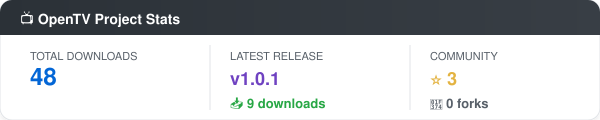
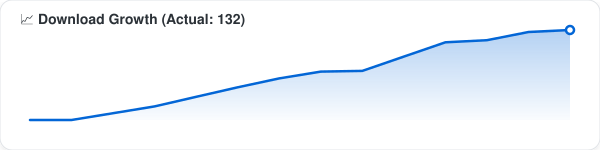
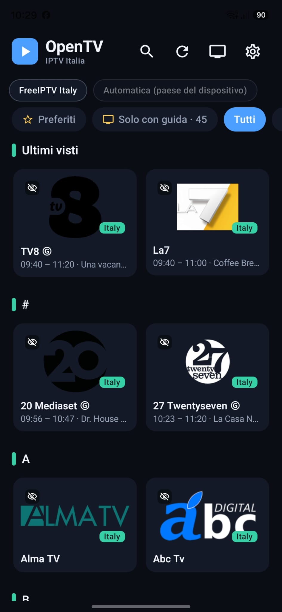
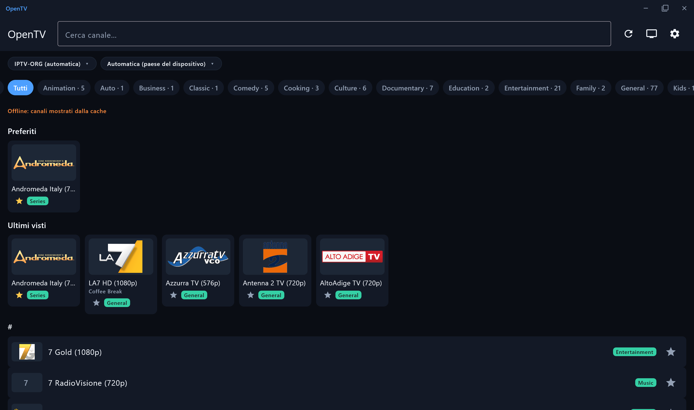
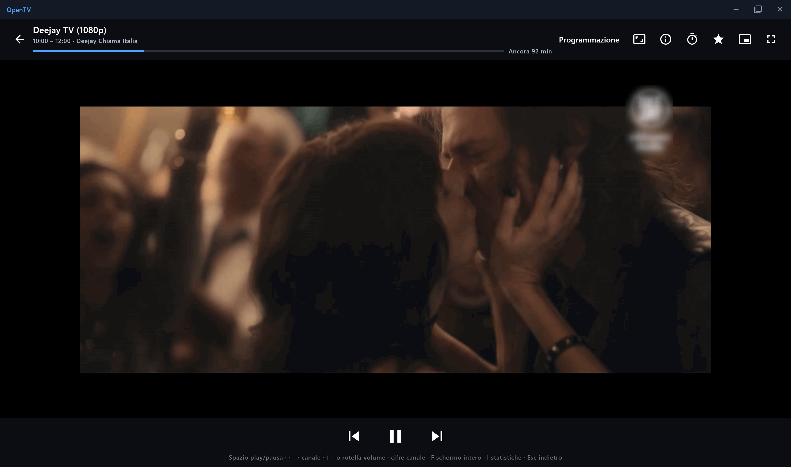

# OpenTV

**Watch free TV on every screen.**

A native, cross-platform IPTV player for free-to-air channels — Android, Android TV, Windows, Linux and macOS.

 

**English** · [Italiano](README.it.md)

---

## What is OpenTV?

OpenTV is a native cross-platform app for watching free-to-air TV channels via IPTV, with a special focus on **Italian channels**. On startup it fetches the public playlist for your country from the [iptv-org](https://iptv-org.github.io/) project, shows it in a sleek **"Dark TV"** interface and plays the available streams.

One app for every device: **phones and tablets**, **Android TV / TV boxes**, Windows and Linux. The same UI adapts focus, sizes and controls to the detected device (D-pad vs touch).

> ⚠️ **Legal note**: OpenTV is a *generic player*. It does not provide, host or select any content: streams come from public third-party playlists. Only use it with channels you may legally watch in your country (e.g. free-to-air channels).

## Highlights

- **Zero setup** — your country's channels are ready at first launch.
- **TV guide included** — now/next, full schedule and a grid guide, all automatic.
- **Made for the living room** — D-pad navigation, TV banner, remote-friendly player.
- **Never miss a show** — program reminders, favorites and history for every source.
- **Keeps playing** — offline fallback, automatic reconnection, 6-hour playlist cache.

**Contents**

- [What is OpenTV?](#what-is-opentv)
- [Highlights](#highlights)
- [Features](#features)
  - [Channels & sources](#channels--sources)
  - [Playback](#playback)
  - [TV guide (EPG)](#tv-guide-epg)
  - [Find channels fast](#find-channels-fast)
- [Android TV & phones](#android-tv--phones)
- [Desktop extras](#desktop-extras)
- [Screenshots](#screenshots)
- [Configuration](#configuration)
  - [Channel playlist](#channel-playlist)
  - [TV guide (XMLTV)](#tv-guide-xmltv)
- [Troubleshooting](#troubleshooting)
- [License](#license)

## Features

### Channels & sources

- **Channels by country (automatic source)** — at startup the app detects the device country (mobile network first, then SIM, then system settings) and loads the curated iptv-org playlist for that country, with the matching TV guide derived automatically and a raw mirror as a backup. Ideal for international use: every installation sees its local channels. From Home, a **flag chip** switches country on the fly — the choice applies immediately and is remembered across restarts, while the default "Automatic" keeps following the device country. Settings hosts the full picker (countries with an iptv-org catalog, sorted by name in the system language), or you can turn the automatic source off and use a **custom URL** (or import a list from a file, which keeps priority). On desktop the country follows the system locale. Flags are emoji on Android and **embedded PNGs** on desktop (source flagcdn.com): Windows has no emoji flag glyphs in its system font and would show the country code instead.

- **IPTV playlist fetching** — M3U/M3U8 download with a dedicated parser (`tvg-id`, `tvg-logo`, `group-title`), local cache with a 6-hour TTL and **offline fallback** to the last valid cache.

- **Export/Import playlist** — back up your channel list to an M3U file, or import one from a local file through the system file picker (SAF); an imported list stays the active source (with offline fallback) until you switch back to a remote URL.

- **Export/Import profile** — every source profile packs into a single `.opentv` file containing the profile (name, playlist URL, guide URL) and its playlist channels, embedded guide included. Import is generic and recognizes the package from its content: the profile is created (or, with a confirmation dialog, overwritten if one with the same name already exists), activated, and its channels become the loaded list. Imported playlists are checked for duplicate channel identifiers and URLs, so the channel list can no longer break on double keys.

### Playback

- **Media3/ExoPlayer engine** — HLS/DASH/MPEG-TS support, cross-protocol redirects, progressive retries for ambiguous streams, audio focus and "becoming noisy" handling (automatic pause when headphones are unplugged).

- **Automatic stream reconnection** — if a stream drops (CDN hiccup, network timeout) the player retries on its own with growing backoff (1.5s, 4s, 8s — up to 3 attempts), showing "Reconnecting… (attempt N of 3)" instead of the error screen; the picture stays on screen and the signal comes back instantly. On Android, the source diagnosis (geo-block, dead link, placeholder…) appears only after the last attempt.

- **Previous / Next** — switch channel straight from the player, just like a remote control.

- **Subtitles** — a subtitle-track menu mirroring the audio-track one, on Android (bottom sheet, ExoPlayer text tracks) and desktop (dropdown, libVLC SPU tracks): a "Disabled" entry is always available, the active track is highlighted, and a CC icon in the bar lights up when subtitles are on. Streams with no text tracks don't show the button; changing channel resets the choice to automatic.

### TV guide (EPG)

- **Automatic EPG (XMLTV)** — with an iptv-org playlist the app loads the country guide from iptv-epg.org on its own (or a manual URL, `.gz` included); playlists that declare **their own guide in the header** (`x-tvg-url`, also as a list of URLs) get it with zero configuration. You get *now on air* and *up next* on cards and in the player, plus the **full channel schedule** (-1h → +24h window, grouped by day) in the Android player (bottom sheet) and on desktop (side panel).

- **Grid TV guide** — a dedicated screen (TV icon in Home): channels on rows, programs on a horizontal timeline, a 4-hour window starting from the current full hour; the **on-air** program is highlighted with the primary border and a live progress bar. Tapping any program (or channel) opens the player directly. Horizontal scrolling is shared and aligned across all rows and the hour ruler, with a "now" marker.

- **Program reminders ("tell me when it starts")** — a bell on every future program in the channel schedule (Android and desktop player): the reminder is stored on the device and, when the program starts, a system notification arrives (dedicated channel on Android, tray balloon on desktop). Entries for programs that ended more than two hours ago (e.g. the device was off) are silently cleaned up; it works with the app in background (Android) or in Home/guide (desktop) too.

### Find channels fast

- **Favorites per source** — long-press a card (or tap the star in the player) and find them all in a dedicated section. **Every list has its own favorites**: the automatic source (iptv-org) and each source profile keep independent lists — when you switch profiles, the Favorites row (with the active list name in its title) only shows the channels you marked on that source, never mixing or losing the others.

- **Recently watched** — an automatic history of the channels you watched, pinned to the top of Home.

- **Live search** — filter by name, ignoring case and accents.

- **Genre filter** — a row of chips under the top bar lists the playlist `group-title` groups (e.g. News, Movies, Sports, Music): one tap shows only the channels of that genre, with a channel count per group. Multi-category channels ("Movies;Series") count in every genre; channels without a group land in "Uncategorized". Combine it with search; "All" clears the filter. **The choice is remembered** across sessions, and every channel card shows a genre badge: on phone and desktop the badge is **tappable** (one tap filters that genre and the chip row aligns itself), on Android TV it stays decorative so D-pad navigation gets no extra focus targets.

## Android TV & phones

- **Android TV** — Leanback launcher, TV banner, full **D-pad** navigation (arrows to move between cards and rows, center button to open, `back` to exit) with focus scale + glow, screen kept on while playing. Banner (`tv_banner`) and adaptive icons included; legacy PNG icons for Android 7.0–7.1.

- **TV player** — **any remote key** (OK, D-pad arrows, media keys) brings up the controls, including the **favorite** button; focus starts on play/pause and every press delays auto-hide by 4 seconds. CH+/CH− (or PageUp/PageDown) jump straight to the next/previous channel, remote play/pause always works, and `back` first hides the controls, then exits the player.

- **Phone** — forced landscape + immersive fullscreen mode.

- **System controls (Android)** — media session on the player: play/pause from the lockscreen and Bluetooth headset buttons, "next/previous track" = next/previous channel, persistent notification with the channel and on-air program plus buttons (previous, play/pause, next). Requires the notification permission on Android 13+ (requested when you open the player): denying it only removes the notification, the controls keep working.

## Desktop extras

**Keyboard & mouse shortcuts in the desktop player**:

| Key | Action |
|-----|--------|
| `Space` | play / pause |
| `←` / `→` | previous / next channel |
| `↑` / `↓` | volume (temporary indicator in the bottom bar) |
| Mouse wheel over the video | volume (one notch = ±10, temporary indicator in the bottom bar; with the pointer outside the video the wheel keeps scrolling the content) |
| `F` | fullscreen / restore window |
| `Esc` | exits fullscreen (if active), otherwise returns to the channel list |

**True fullscreen** — it also activates from the **bar button** in the player (an icon that toggles enter/exit based on the window state); leaving the channel returns the window to normal mode automatically.

Fullscreen is **really edge-to-edge**: the desktop window drops the system decorations and the title bar (minimize/maximize/close, draggable, double-click = maximize) is drawn by the app in the same dark style as the UI. It is implemented borderless (window bounds are moved to screen bounds) for identical rendering and a transition without flicker or white flashes.

Player bars **fade out after 4 seconds of inactivity in every mode** (windowed and fullscreen); in fullscreen the cursor hides too, and the first mouse move or any key brings everything back. The bars live in **fixed-size slots** outside the video area: hiding them is a purely graphical effect (a fade) and the video surface is **never resized or covered** — the spots left free stay black, consistent with the theme. In windowed mode the title bar stays available to drag and close the window.

**Numeric zapping** — in the player, type the channel digits ("103") and channel 103 of the playlist opens on the fly: digits appear in a chip in the bar, the channel tunes when the buffer expires (1.2s) or on Enter, backspace corrects.

**Stream statistics** — a VLC-style panel in the player (`I` key or ⓘ button): video codec and resolution, fps, audio codec and bitrate, demux bitrate and the losses reported by libVLC (frames, audio buffer, discontinuities, corrupted packets) — handy to understand why a channel stutters. Data lives in the bar, never over the video (the surface is a native component that would cover any overlay).

**Mini-player** — the PiP button in the player moves playback to an always-on-top little window in the bottom-right corner: watch the match while browsing the guide or Home. Draggable strip with title, expand button (reopens the full player) and close; opening a channel closes it by itself (one active playback only).

## Screenshots

| Home (phone)                                           | Home (Android TV / Desktop)                               | Player                                                 |
|--------------------------------------------------------|-----------------------------------------------------------|--------------------------------------------------------|
|  |  |  |

## Configuration

### Channel playlist

- **Default**: `https://iptv-org.github.io/iptv/countries/it.m3u` (channels available in your country, listed by the iptv-org community, updated daily).
- **Custom**: *Settings → Playlist URL (M3U)* to use your own playlist (direct URL to a `.m3u`/`.m3u8` file, gzip-served included).

Settings also offer **restore defaults** and a **real-time loading status**.

### TV guide (XMLTV)

**Automatic (default)**: with an iptv-org playlist (e.g. the default Italian one) the app loads the **per-country** guide from [iptv-epg.org](https://iptv-epg.org) — the community service that publishes the EPG of the iptv-org ecosystem (same toolchain as the [iptv-org/epg](https://github.com/iptv-org/epg) repo and same channel database).

**Settings → XMLTV guide URL**: for a **manual** guide (or self-hosted with the iptv-org/epg tool: `npm run grab` → serve it and paste the URL). The manual URL always takes priority over the automatic one. The file is streamed (`.xml.gz` included), decompressed and filtered to a **-1h → +24h** window from now.

## Troubleshooting

| Problem | Likely cause | Solution |
|---|---|---|
| "Network unreachable" | no connection / DNS | check the network; without one the app uses the last cache |
| Some channels don't start | dead stream or codec unsupported by the device | move to the next channel; try another playlist URL |
| HTTP 403 error | the server filters the User-Agent | the app sends a browser UA; some servers require specific referers |
| Empty EPG | wrong XMLTV URL, mismatched `tvg-id` or channels with no published guide | use a guide with the same `tvg-id` as the playlist (with iptv-org: the automatic one or the per-country buttons); local/web TVs often have no EPG available |
| Video without audio in background | audio focus ceded to another app | expected Android behavior |

## License

Released under the [MIT](LICENSE) license.
The content played belongs to its respective owners; the default playlist is provided by the [iptv-org](https://github.com/iptv-org/iptv) project.

---

 <i> Made with ❤️ by <a href="https://github.com/fast4x">Fast4x</a> </i>

